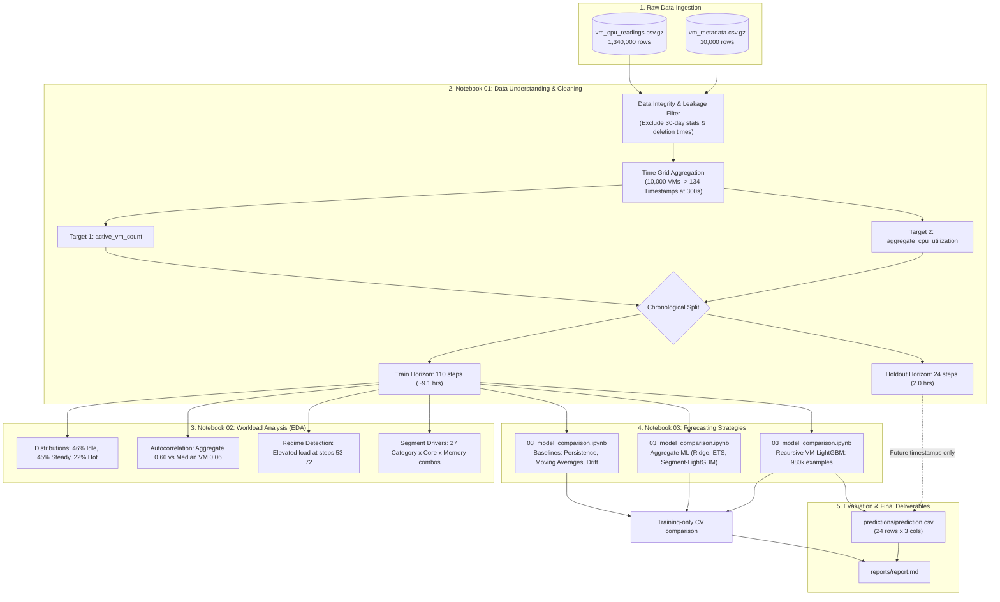
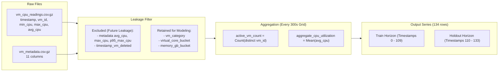
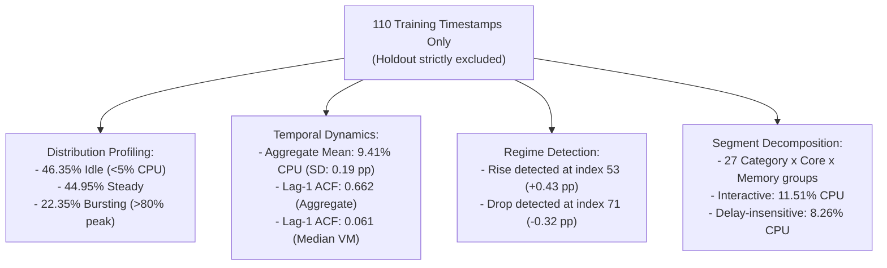
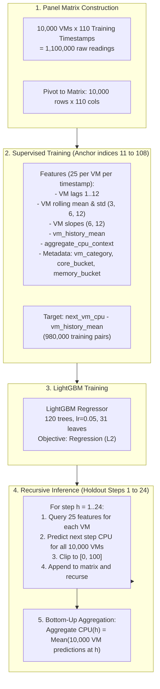
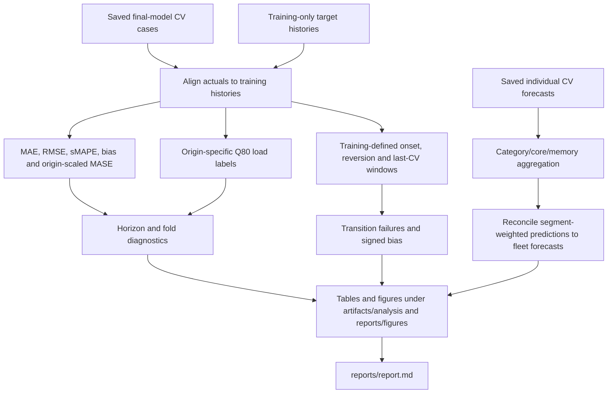
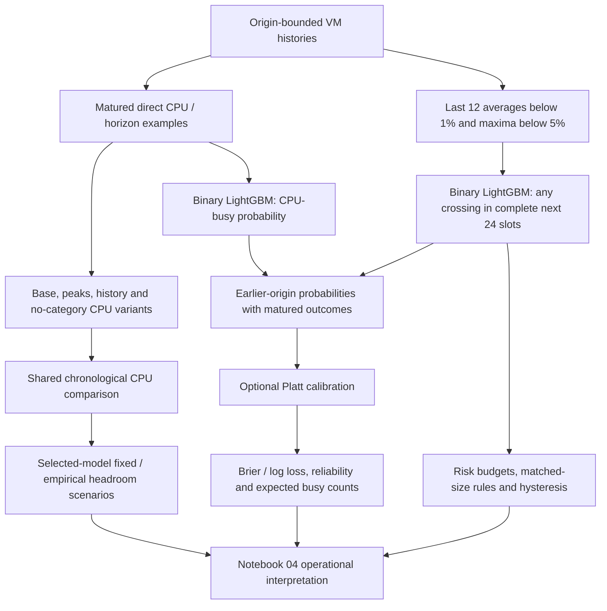

# End-to-End System and Workflow Architecture

This document maps the complete data preparation, analysis, training, validation,
forecasting and operational workflows to the current repository. The final CPU
model is recursive VM LightGBM; the final count rule is observed-count persistence.
The sole submission export is [prediction.csv](../predictions/prediction.csv).

Read the [report](../reports/report.md) for findings and the
[methodology](../reports/model_methodology.md) for equations and column usage.
All model fitting and calibration use eligible historical observations. The viewed
holdout does not provide an independent final-model test.

## 1. High-Level System Architecture

The following diagram illustrates the complete data lifecycle: from raw telemetry ingestion to quality checks, feature extraction, cross-validation, and holdout prediction generation.



---

## 2. Notebook 01: Data Understanding & Preprocessing
📁 **Location:** `notebooks/01_data_understanding.ipynb`  
📁 **Module Code:** `src/cwfc/quality.py`, `src/cwfc/targets.py`

### Workflow Diagram



### Column Specifications

| Input Source | Columns Inspected | Action / Status |
|---|---|---|
| `vm_cpu_readings.csv.gz` | `timestamp`, `vm_id`, `min_cpu`, `max_cpu`, `avg_cpu` | Verified: 0 missing values, strict 300-second cadence, $0 \le \min \le \text{avg} \le \max \le 100$. |
| `vm_metadata.csv.gz` | `vm_category`, `virtual_core_bucket`, `memory_gb_bucket` | Retained as static categorization features. |
| `vm_metadata.csv.gz` | `avg_cpu`, `max_cpu`, `p95_max_cpu`, `timestamp_vm_deleted` | **Excluded from predictors:** CPU summaries extend beyond the cutoff; deletion metadata can reveal future information. |

**Constructed Targets (134 time steps):**
- `active_vm_count`: Distinct VMs with a valid reading in the interval.
- `aggregate_cpu_utilization`: Mean of VM `avg_cpu` readings across the cluster.

---

## 3. Notebook 02: Workload Analysis (EDA)
📁 **Location:** `notebooks/02_workload_analysis.ipynb`  
📁 **Module Code:** `src/cwfc/eda.py`

### Workflow Diagram



### Key Analytical Takeaways
1. **The Aggregation Effect:** Individual VM traces have median lag-one autocorrelation $\approx 0.061$, whereas the aggregate has $\text{ACF}_1 = 0.662$. Aggregation smooths individual variation; these statistics alone do not establish an irreducible noise floor.
2. **Mean-Reversion:** Workload moves within a narrow band (mean 9.41%, SD 0.19 pp) and exhibits mean-reverting behavior after transient spikes.

---

## 4. Notebook 03: Baselines and Validation
📁 **Location:** `notebooks/03_model_comparison.ipynb`  
📁 **Module Code:** `src/cwfc/baselines.py`, `src/cwfc/validation.py`

### Expanding-Window Backtest (7 Folds)

| Fold | History indices | Validation indices | Forecast steps |
| --- | --- | --- | ---: |
| 1 | 0–47 | 48–71 | 24 |
| 2 | 0–53 | 54–77 | 24 |
| 3 | 0–59 | 60–83 | 24 |
| 4 | 0–65 | 66–89 | 24 |
| 5 | 0–71 | 72–95 | 24 |
| 6 | 0–77 | 78–101 | 24 |
| 7 | 0–83 | 84–107 | 24 |

Each fold refits using only its history. The 168 decisions cover 60 distinct
observations; overlapping windows and shared VM histories are correlated.


### Baseline Performance on Training-Only CV

| Baseline Model | Forecasting Rule | CPU CV MAE (pp) | CPU CV RMSE (pp) |
|---|---|---:|---:|
| **Moving Average (k=3)** | $\hat{y}_{t+h} = \frac{1}{3}\sum_{i=0}^2 y_{t-i}$ | 0.2439 | 0.2953 |
| **Persistence (Naive)** | $\hat{y}_{t+h} = y_t$ | 0.2655 | 0.3174 |
| **Seasonal Naive (24)** | $\hat{y}_{t+h} = y_{t+h-24}$ | 0.3210 | 0.3611 |

---

## 5. Notebook 03: Aggregate Features and Candidate Models
📁 **Location:** `notebooks/03_model_comparison.ipynb`  
📁 **Module Code:** `src/cwfc/features.py`, `src/cwfc/models.py`

### Feature Pipeline & Model Comparison

```mermaid
flowchart LR
    subgraph FeatEng["Feature Extraction at Forecast Origin (t)"]
        L["Lags: lag_1 to lag_12"]
        R["Rolling Statistics: mean_w, std_w for w in (3, 6, 12)"]
        S["Rolling Slopes: slope_6, slope_12"]
        C["Segment Mix: category CPU means & population shares"]
    end

    subgraph Models["Candidate Models Tested"]
        RIDGE["Direct Ridge Regression<br>(39 features per horizon step)"]
        ETS["Damped ETS / SES"]
        THETA["Theta Method"]
        LGB_SEG["Segment LightGBM<br>(27 pooled segment series)"]
        ENS["Sequential Ensemble"]
    end

    FeatEng --> Models
    Models --> RES["Compare MAE, RMSE and persistence skill on identical cases;<br>the final forecast uses recursive VM LightGBM."]
```



### Feature Inventory (39 Predictors Available at Origin $t$)
1. **Historical Lags:** $y_{t-1}, y_{t-2}, \dots, y_{t-12}$ (past 60 minutes).
2. **Rolling Aggregates:** Mean and sample standard deviation across windows $w \in \{3, 6, 12\}$.
3. **Trend Slopes:** OLS linear slopes over 6 and 12 steps.
4. **Category Breakdown:** Real-time observed mean CPU and proportion of VMs in `Interactive`, `Delay-insensitive`, and `Unknown`.

---

## 6. Notebook 03: Final Recursive VM LightGBM
📁 **Location:** `notebooks/03_model_comparison.ipynb`  
📁 **Module Code:** `src/cwfc/model.py`

### End-to-End Per-VM Workflow



### Training vs. Inference Column Breakdown

```
Input Features (25):
├── Telemetry and Context (22)
│   ├── lag_1 to lag_12         (Individual VM past CPU values)
│   ├── mean_3, std_3           (3-step rolling statistics)
│   ├── mean_6, std_6           (6-step rolling statistics)
│   ├── mean_12, std_12         (12-step rolling statistics)
│   ├── slope_6, slope_12       (Recent trend trajectory)
│   ├── vm_history_mean         (Individual VM's historical baseline)
│   └── aggregate_cpu_context   (Overall cluster CPU level at anchor)
└── Static Metadata (3)
    ├── vm_category             (Interactive, Delay-insensitive, Unknown)
    ├── virtual_core_bucket     (Bucketed vCPU cores)
    └── memory_gb_bucket        (Bucketed RAM)

Target (1):
└── residual = next_vm_cpu - vm_history_mean
```

### Feature Importance Ranking (Empirical Gain)

```
vm_history_mean        ██████████████████████████████ 70.4M
lag_1                  █████████████████████████ 60.5M
slope_12               █████████████████ 40.2M
mean_12                ██ 6.6M
mean_3                 ██ 5.8M
lag_2                  ██ 5.8M
...
memory_gb_bucket       ▍ 1.35M
vm_category            ▎ 0.65M
virtual_core_bucket    ▏ 0.08M  (Lowest importance)
```

---

## 7. Modeling Units and Final Model Selection

All fitting workflows are retained in [notebook 03](../notebooks/03_model_comparison.ipynb).

| Approach | Modeling unit | Inputs | Forecast strategy |
| --- | --- | --- | --- |
| Baselines | Aggregate target histories | Observed target values | Persistence, moving averages, drift and seasonal negative control |
| Aggregate statistical/linear models | Fleet series | Historical levels or origin-safe predictors | SES, ETS, Theta and per-horizon ridge |
| Segment LightGBM | 27 category/core/memory series | Segment dynamics, static labels, aggregate context and horizon | Shared direct multi-horizon model, population-weighted aggregation |
| Final VM LightGBM | 10,000 VM histories | 25 VM/context/category features | Shared next-step residual model, recursive prediction and unweighted aggregation |
| Direct VM ablations | Individual VM/anchor/horizon examples | Base, peak/history additions or category removal | Horizon-conditioned residual prediction without recursive CPU feedback |

The final VM model has 980,000 supervised examples on this release. Those
examples do not create additional independent observation periods. Settings are
120 trees, learning rate 0.05, 31 leaves, minimum 100 child samples and seed 42.

| CPU forecast / benchmark | CV MAE (pp) | CV RMSE (pp) |
| --- | ---: | ---: |
| Final recursive VM LightGBM | 0.19881 | 0.26889 |
| Persistence benchmark | 0.26550 | 0.31736 |
| Moving-average benchmark (3) | 0.24385 | 0.29532 |
| Segment LightGBM comparison | 0.26926 | 0.30750 |

Selection uses pooled chronological CV MAE, with RMSE and model-name tie breaks.
The current final recipe remains [final_model.yaml](../configs/final_model.yaml).
Observed-count persistence is implemented in [predict.py](../src/cwfc/predict.py).
The Holt-count comparator is retained in [count_model.py](../src/cwfc/count_model.py)
and notebook 03; its zero error on this constant population does not establish churn skill.

## 8. Notebook 04: Error and Failure Analysis

**Notebook:** [04_error_analysis.ipynb](../notebooks/04_error_analysis.ipynb)  
**Code:** [analysis.py](../src/cwfc/analysis.py), [validation.py](../src/cwfc/validation.py)



Origin-safe Q80 labels differ from the full-training retrospective high-load
labels. Negative bias means underprediction. MASE uses each origin's historical
one-step naive error scale; zero scales are undefined. The transition windows
are selected from workload changes rather than residuals. Per-VM and behavior
errors expose mistakes that may cancel in the fleet mean.

Previously recorded persistence holdout observations are retained as benchmark
context. They are not final-model holdout results and do not choose the final
model. No new holdout evaluation occurs in this analysis path.

## 9. Supplementary Activity, Risk and Capacity Workflows

**Training code:** [direct.py](../src/cwfc/direct.py),
[operational.py](../src/cwfc/operational.py)  
**Evaluation code:** [operational_evaluation.py](../src/cwfc/operational_evaluation.py),
[capacity.py](../src/cwfc/capacity.py), [uncertainty.py](../src/cwfc/uncertainty.py)



Point-busy labels mature at each forecast observation. Activity-event labels
require the entire 24-step future window. Calibration excludes current-fold and
unmatured outcomes. Both classifiers exclude workload category.

The optional full training run is controlled by `RETRAIN_OPERATIONAL` in notebook
03 or `python -m cwfc.operational`. Supporting CPU/activity forecasts, candidate
lists, model fits and diagnostics stay under `artifacts/operational/`.

Category quantile scenarios are a separate training-only persistence experiment.
[capacity.yaml](../configs/capacity.yaml) defines cost-ratio quantiles, margins,
fixed-buffer comparators and a slope-trigger scenario. Exact-horizon P90 requires
nine matured residuals; seven folds cannot support it. Unsupported bounds use
100% CPU and explicitly expose the calibration gap. This differs from the
selected-model empirical margin, which pools six-step horizon bands and uses a
0.5 pp warmup margin.

The operational results support demand planning and human review. CPU shortfalls
are not observed SLA breaches, candidate VM-hours overlap, and resource buckets
do not identify exact cores or safe shutdown eligibility.

## 10. Outputs and Reproduction

| Output | Purpose |
| --- | --- |
| [predictions/prediction.csv](../predictions/prediction.csv) | Sole final 24-row, three-column forecast |
| `artifacts/final_model/` | Final-model cases, individual predictions, feature gains and provenance |
| `artifacts/comparison/` | Retained candidate-comparison evidence |
| `artifacts/model_selection/` | Notebook-generated statistical/segment comparison and ensemble evidence |
| `artifacts/operational/` | Busy/risk predictions, candidate decisions, headroom and category bounds |
| `artifacts/analysis/` | Rebuilt final-model residual and policy summaries |
| [reports/report.md](../reports/report.md) | Complete findings, failures and operational recommendations |
| [reports/model_methodology.md](../reports/model_methodology.md) | Column usage, equations and methodological definitions |

```powershell
python -m cwfc.predict
python -m cwfc.validation
python -m cwfc.analysis
python -m cwfc.capacity
```

Run the four notebooks in order for the complete exploratory and training
workflow. See [README](../README.md) for installation and data preparation.
The forecast manifest records input, configuration, source and output hashes.
The final CSV contains `timestamp`, `active_vm_count` and
`aggregate_cpu_utilization`; counts are nonnegative and CPU is in [0,100].
