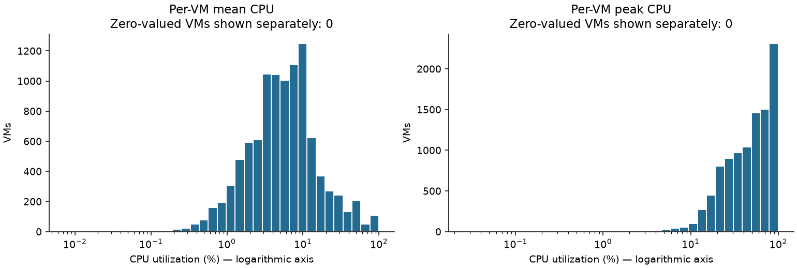
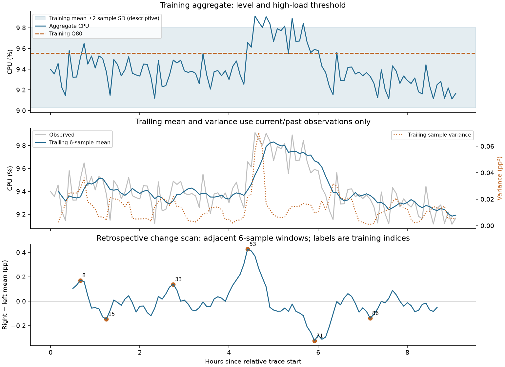
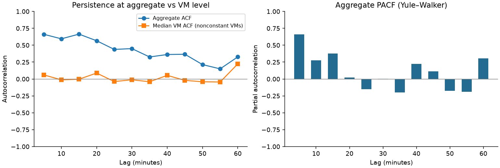
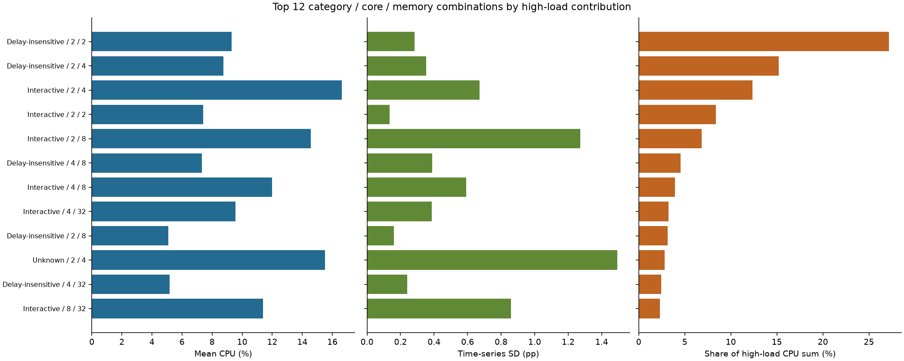
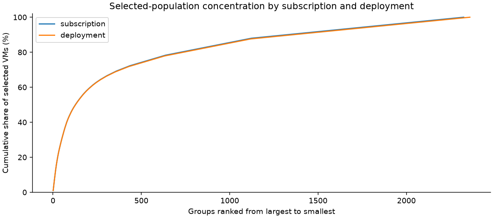
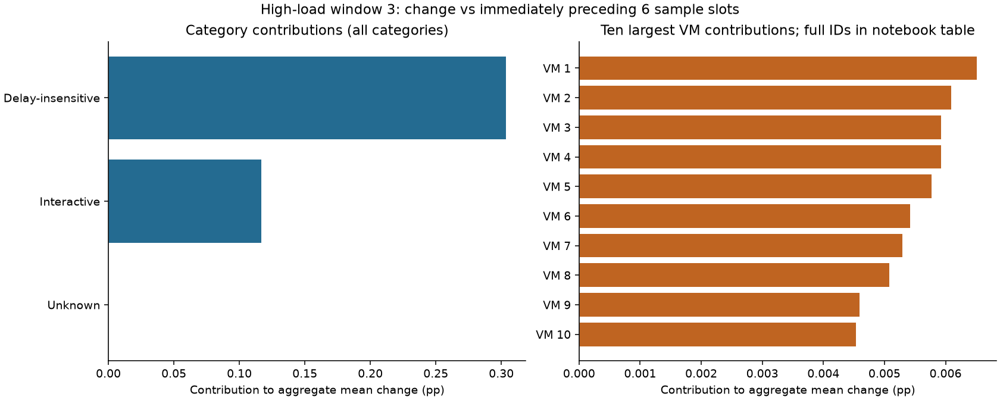
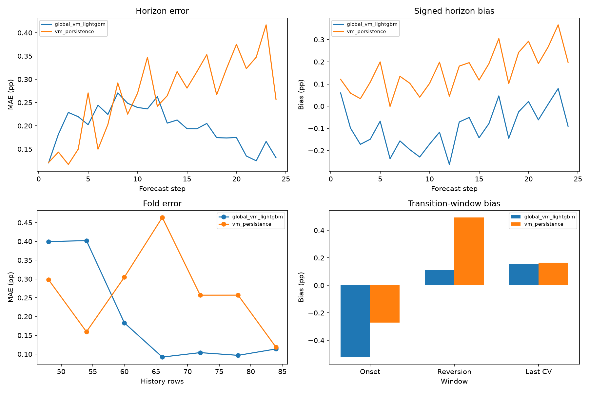
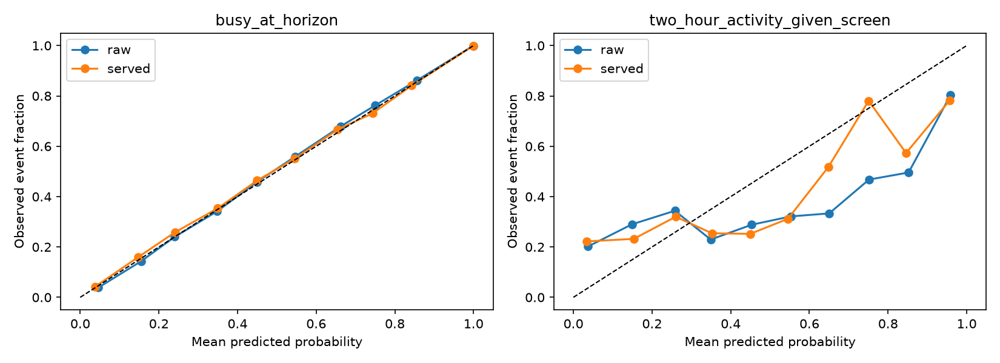
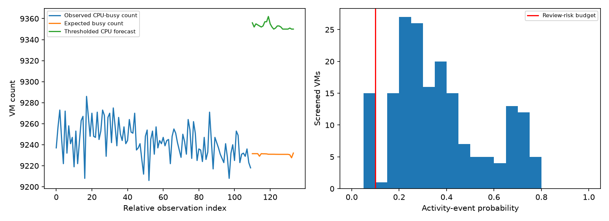

# Cloud Workload Forecasting — Final Report

## 1. Executive summary

The final CPU forecast is a shared recursive VM LightGBM, with chronological CV MAE **0.19881 percentage points**, RMSE **0.26889 pp**, and **25.12%** MAE improvement over persistence. It averages forecasts for the observed cutoff VM population and uses observed-count persistence for the required count target. The sole final export is [prediction.csv](../predictions/prediction.csv).

The complete-trace population has stable mean CPU but heterogeneous individual demand. Low average CPU can coexist with peaks, and the main elevated-load episode is distributed across many VMs. The final model underpredicts **93.33%** of retrospective high-load cases; its pooled advantage does not imply peak protection.

Bonus experiments examine direct feature ablations, CPU-busy counts, calibrated activity probabilities, low-use review candidates and headroom. At the final origin **186 VMs** pass the recent low-use screen and **15** meet the fixed risk budget. These are review opportunities, not established shutdown eligibility. The classifier does not outperform the matched recent-average review rule sufficiently to justify automated removal.

Detailed equations and column use are in [model_methodology.md](model_methodology.md). Four complete notebooks retain preprocessing, analysis, actual model fitting and validation, and operational/error investigation.

## 2. Data understanding and preprocessing

### 2.1 Missing values — the main cleaning check

Missingness was checked column by column on the raw files, before preprocessing.

| File | Columns checked | Total missing cells | Decision |
|---|---:|---:|---|
| CPU readings | All 5 | **0** | No missing-value treatment needed |
| VM metadata | All 11 | **0** | No missing-value treatment needed |

The readings check includes `timestamp`, `vm_id`, `min_cpu`, `max_cpu` and
`avg_cpu`. The metadata check includes identifiers, creation/deletion times,
CPU statistics, category and resource buckets. Every individual column has
zero missing values; the notebook displays each column separately.

### 2.2 Duplicates, validity and time continuity

| Check | Measured result | Meaning |
|---|---:|---|
| Duplicate `(vm_id, timestamp)` rows | **0** | No VM receives extra weight from duplicate rows |
| CPU rows outside [0,100] | **0** | No out-of-range correction required |
| Rows violating min ≤ average ≤ max | **0** | CPU statistics are internally consistent |
| Missing five-minute grid timestamps | **0** | No timestamp-gap handling needed on this release |
| Consecutive timestamp differences | **300 seconds throughout** | Chronology follows the required cadence |
| VMs with incomplete valid coverage | **0** | Every selected VM is observed throughout the window |
| Duplicate metadata VM rows | **0** | One metadata record per selected VM |
| VM populations in readings and metadata | **Exact match** | No unmatched IDs in either direction |
| Deletion timestamps earlier than creation | **0** | No reversed recorded lifetimes |

**Preprocessing outcome:** 1,340,000 input rows → 1,340,000 prepared rows.
Zero rows were excluded or combined, and zero VM-level values were imputed.
These findings establish data validity; they do not establish forecastability.

### 2.3 Release contract verification

The dataset size and cadence were already documented. Rechecking them serves
as a consistency check on the downloaded files, rather than a new workload insight.

| Property | Verified value |
|---|---|
| File integrity | All 3 SHA-256 manifest entries passed |
| Readings / metadata rows | 1,340,000 / 10,000 |
| Distinct VMs / timestamps | 10,000 / 134 |
| Relative observation timestamps | 0 through 39,900 seconds |
| First-to-last observation span | 11 hours 5 minutes |
| Coverage per selected VM | 134 of 134 timestamps (100%) |
| Observed VM count at each timestamp | 10,000 |

Timestamps remain integer relative seconds. No calendar date or hour-of-day
is inferred. CPU columns use float64 and identifiers use categorical dtypes.

### 2.4 Policy for imperfect replacement data

The pipeline handles data quality explicitly, even though this release is clean.

| Situation | Treatment |
|---|---|
| Duplicate VM/timestamp rows | Average CPU columns within the key; log the number combined |
| Missing CPU statistic | Exclude the incomplete observation and log it; no VM-level imputation |
| Entire timestamp absent | Reindex to the 300-second grid; observed count = 0 and mean CPU = NaN; flag the slot |
| Partial VM coverage | Count the VM only where a valid observation exists |
| Invalid CPU, missing key or off-grid timestamp | Stop preparation and require source review |
| Missing target values | Keep them missing; do not invent training targets |

The synthetic preprocessing example produces:

| Relative timestamp (seconds) | Observed VMs | Aggregate mean CPU (%) |
|---|---:|---:|
| 0 | 2 | 17.5 |
| 300 | 0 | Missing |
| 600 | 1 | 15.0 |

**Interpretation:** duplicate averaging gives equal weight to each VM: VM a's
readings average to 25%, and VM b contributes 10%, producing 17.5% across two
VMs. The absent timestamp remains visible without CPU imputation. Partial
coverage changes the observed count only where a VM has a valid reading.

### 2.5 Lifetimes, survivorship and leakage

| Observation | Measured result | Interpretation / decision |
|---|---:|---|
| Creation recorded at relative zero | 10,000 VMs | Consistent with left censoring; do not infer simultaneous creation |
| Recorded deletion after the observation window | 10,000 VMs | Future information; exclude from forecast inputs |
| Earliest recorded deletion | 40,500 seconds | 600 seconds after the final reading |
| Deletions within six hours after the window | 37 VMs | Descriptive only; cannot drive origin-time forecasts |
| Deletions by relative day one | 122 VMs | Relative to trace start, not an absolute calendar day |
| Deletion recorded at source endpoint 2,591,400 seconds | 8,213 VMs | Endpoint recording does not establish actual deletion at that instant |

The data card states that only VMs with complete traces were eligible. The
constant observed count therefore reflects **survivorship bias**. It cannot
support conclusions about fleet-wide creation or deletion rates.

Metadata `avg_cpu`, `max_cpu` and `p95_max_cpu` summarize source lifetimes and
may contain holdout or later information. Exclude them, deletion timestamps and
derived lifetimes from forecast inputs. Do not use metadata CPU averages to fill
missing readings. Category and resource buckets remain available for later
descriptive segmentation.

## 3. Workload analysis

**Analysis scope:** All findings below use the **110 training
timestamps only** (0–32,700 relative seconds). Holdout target values are excluded.
Calculations live in [`cwfc.eda`](../src/cwfc/eda.py); the executed
[workload notebook](../notebooks/02_workload_analysis.ipynb) explains each rule,
shows calculation logic, result tables and six figures. Interpretations follow the corresponding evidence in this report.

### 3.1 Distributions and VM behavior

For each VM, calculate historical average `avg_cpu`, sample SD and maximum `max_cpu`.
The distributions use logarithmic CPU axes, with zero-valued VM counts stated
separately. The descriptive rules below are fixed conventions and may overlap;
they are not exhaustive classes or tuned forecasting parameters.

| Indicator | Definition | VMs | Share |
|---|---|---:|---:|
| Idle | historical average avg_cpu < 5% | 4,635 | 46.35% |
| Steady | historical average >= 5% and std/mean <= 0.5 | 4,495 | 44.95% |
| Hot | At least one training max_cpu > 80% | 2,235 | 22.35% |

The median VM mean CPU is **5.50%**. There are **151 VMs** that are idle on average yet have at least one hot
interval. The busiest **100 VMs** contribute **9.60%** of summed observed
VM CPU percentages. This is a utilization-sum proxy, not core-weighted resource
consumption; bucketed hardware metadata does not provide exact resource sizes.



**Operational meaning:** low average utilization can coexist with bursts.
Review both average load and burst exposure before proposing headroom.

### 3.1.1 Observed population versus CPU-busy population

A further check used only the 1,100,000 readings in the first 110 timestamps.
No VM reading has `avg_cpu == 0`, and no VM has zero interval maximum CPU.
There are 83 readings with `min_cpu == 0`; an interval minimum of zero does
not mean the VM was idle throughout its five-minute interval.

| CPU condition | VMs at timestamp 0 | Minimum VMs per training timestamp | Maximum VMs per training timestamp |
|---|---:|---:|---:|
| Average CPU exactly 0% | 0 | 0 | 0 |
| Average CPU below 0.1% | 24 | 23 | 29 |
| Average CPU below 1% | 763 | 714 | 794 |
| Average CPU below 5% | 4,946 | 4,758 | 5,012 |
| Average CPU greater than 0% | 10,000 | 10,000 | 10,000 |

Across whole VM histories, **16 VMs** stay below 0.1% average CPU at every
training timestamp, **91** stay below 1%, and **1,627** stay below 5%.
The lowest-mean VM (`UicSN3MR…`, shortened identifier) has a historical average of
**0.007345%**, with interval-average values from **0.007159% to 0.007529%**.
Threshold counts are saved in
[`training_cpu_activity_thresholds.csv`](../artifacts/workload_analysis/training_cpu_activity_thresholds.csv).

**Operational interpretation:** there is substantial low-utilization behavior,
but a strict `avg_cpu > 0` definition still counts all 10,000 VMs at every
training timestamp. A threshold-based CPU-busy count would be a distinct
operational target. The dataset contract defines required `active_vm_count`
as unique VMs with valid observations; that forecast is not an instruction
to allocate 10,000 VMs at every timestamp. Capacity recommendations must
separately consider workload consolidation, peak risk, heterogeneous VM sizes
and headroom. Low CPU alone does not establish that a VM can be shut down or
that its workload can be migrated without other constraints.

### 3.2 Temporal behavior and aggregation

Training aggregate CPU averages **9.4141%**, with sample SD **0.1936 pp**.
The plotted mean ±2 SD band describes training variation, not forecast uncertainty.
Trailing mean/variance use six samples (30 minutes), with at least three valid
observations during startup; missing values are not filled.

The retrospective change scan compares the next six samples with the preceding
six. Its strongest rise is **+0.4263 pp near index 53 (4.42 h)**, and its strongest
fall is **−0.3243 pp near index 71 (5.92 h)**. This locates the elevated region
around indices **53–72**, approximately **4.4–6.0 relative hours**. The notebook
lists the six strongest separated local candidates. These are descriptive
boundaries, not significance-tested changes or online forecast features.



**Operational meaning:** later validation must inspect both the rise and the
return toward normal. Detecting the event after it occurs does not establish
that it was predictable.

Five-minute ACF is **0.662 for the aggregate**, versus **0.061 for the
median VM** using the same centered, unadjusted ACF definition. All 10,000 VMs
are eligible at lag one. Median VM CV is **0.285**, versus **0.021** for the aggregate.
Aggregate Yule–Walker PACF is also shown through lag 12. ACF retains missing time
positions; PACF is omitted on incomplete, constant or insufficient replacement
series rather than inventing observations.



**Operational meaning:** aggregation smooths much individual variation, consistent
with the law-of-large-numbers intuition, without proving independence. Compare
aggregate persistence and short moving averages before adding complexity. ACF
alone does not choose a model or establish accuracy; the regime shift contributes
to the observed correlation.

### 3.3 Segments and shared-group concentration

For each category × core-bucket × memory-bucket combination, calculate mean CPU
at each timestamp, its mean level and sample SD over time. High-load share is the
segment's summed VM `avg_cpu` during training high-load timestamps divided by the
corresponding sum across all segments. All **27 observed combinations** are saved
in `artifacts/workload_analysis/segments.csv`; the notebook displays the top 20 by contribution.

| Category | VMs | Mean CPU (%) | Temporal SD (pp) | High-load CPU share |
|---|---:|---:|---:|---:|
| Interactive | 3,091 | 11.505 | 0.243 | 37.46% |
| Unknown | 729 | 10.355 | 0.629 | 7.74% |
| Delay-insensitive | 6,180 | 8.257 | 0.217 | 54.80% |

The largest detailed high-load contributors are:

| Category / core bucket / memory bucket | VMs | Mean CPU (%) | Temporal SD (pp) | High-load share |
|---|---:|---:|---:|---:|
| Delay-insensitive / 2 / 2 | 2,708 | 9.303 | 0.284 | 27.18% |
| Delay-insensitive / 2 / 4 | 1,602 | 8.762 | 0.352 | 15.18% |
| Interactive / 2 / 4 | 697 | 16.639 | 0.670 | 12.35% |



**Operational meaning:** Unknown is the most volatile category, while the much
larger Delay-insensitive population supplies the largest high-load CPU share.
Monitor variability and contribution together; category averages alone can hide
large differences between resource buckets. Numerical headroom margins still
require validation and cost assumptions.

| Grouping | Distinct groups | Largest group | Top 10 VM share | HHI | Effective groups |
|---|---:|---:|---:|---:|---:|
| Subscription | 2,324 | 96 VMs (0.96%) | 8.84% | 0.00282 | 355.0 |
| Deployment | 2,359 | 96 VMs (0.96%) | 8.84% | 0.00281 | 356.0 |

HHI is the sum of squared group VM shares; its reciprocal is the effective number
of equally sized groups.



**Operational meaning:** many VMs share subscriptions/deployments, so monitor
shared-group exposure. These counts describe the selected population. Size
concentration does not prove correlated demand or common-cause failure.

### 3.4 High-load windows, lows and drivers

Training Q80 is **9.5545%**; high load is **strictly above** it.
Training Q20 is **9.2574%**; low load is **strictly below** it.
Contiguous selected timestamps form windows, with ties excluded. These are
relative workload labels, not absolute capacity or SLA thresholds.

For each high window, compare its mean with the immediately preceding six slots
(or fewer at the start). Divide each VM's reading by the observed count at its
timestamp, average those contributions within each window, and subtract the
baseline. VM contributions reconcile exactly to aggregate change; category
contributions are their sums. This accounts for changing observed populations
without imputing VM readings and does not establish causal drivers.

| High window | Training indices | Relative hours | Samples | Mean CPU (%) | Prior mean (%) | Change (pp) | Leading category |
|---|---|---|---:|---:|---:|---:|---|
| 1 | 5–5 | 0.42–0.42 | 1 | 9.5803 | 9.3146 | +0.2657 | Delay-insensitive |
| 2 | 9–9 | 0.75–0.75 | 1 | 9.6477 | 9.3506 | +0.2971 | Interactive |
| 3 | 53–63 | 4.42–5.25 | 11 | 9.7847 | 9.3645 | +0.4202 | Delay-insensitive |
| 4 | 65–72 | 5.42–6.00 | 8 | 9.6833 | 9.7400 | -0.0567 | Interactive |
| 5 | 77–77 | 6.42–6.42 | 1 | 9.5627 | 9.3918 | +0.1708 | Interactive |

The strict threshold splits the broad elevated region into windows 53–63 and
65–72 because index 64 falls below Q80. Window 65–72 is still high in level but
falls relative to its already elevated preceding baseline. High load and rising
load therefore must not be used interchangeably.

The main window, 53–63, averages **9.7847%** versus a preceding **9.3645%**,
a rise of **0.4202 pp**. Its category contributions are:

| Category | Contribution to aggregate change (pp) |
|---|---:|
| Delay-insensitive | +0.303541 |
| Interactive | +0.116651 |
| Unknown | +0.000029 |

The leading VM has ID prefix **`xLbiuzphbqoX`**. The 20 largest VM
contributions explain **22.03%** of the net rise under this baseline definition.
Full IDs, ranked top-ten contributions and an expandable ID table appear in the
notebook; all windows' VM/category contributions are saved as CSVs. The net-rise
share is unavailable when a window declines and can exceed 100% if other VMs
offset positive changes; it is never clipped.



**Operational meaning:** the rise is distributed beyond the top 20 VMs. Review
the broader category movement as well as individual bursts, rather than assuming
one noisy VM explains the event.

There are **12 low-load windows**. Their training-index spans are
**3–4, 16, 28, 30–31, 43, 52, 75–76, 88, 90–91, 99–100, 102–104, 106–109**.
The notebook lists each window's timestamps, mean and minimum. These periods
provide comparison cases; they are not safe capacity floors.

### 3.5 Reproducing the analysis

Run all cells of `notebooks/02_workload_analysis.ipynb` with the project `.venv`
to regenerate the six figures and complete training-only evidence tables in
`artifacts/workload_analysis/`. Report figures and compact evidence tables are retained; large raw artifacts are ignored by Git. The
notebook retains rendered outputs and the report records measured findings.

## 4. Final forecasting method

One squared-error LightGBM learns next-step deviations from each VM's own past CPU level. Its 25 features include lags, rolling means and standard deviations, slopes, historical VM level, fleet context and three categorical workload/resource labels. The model appends each predicted value to history, rebuilds features and repeats through all 24 steps. No future actual observation enters this recursion.

The final fit uses 1.10 million historical readings and 980,000 supervised next-step examples. These examples come from only 110 timestamps; cross-VM pooling does not create independent time periods. Future population membership is fixed at the final observed cutoff. Count persistence gives 10,000 for this complete-trace release and does not demonstrate general churn skill.

### 4.1 Additional candidate families and controlled feature experiments

The aggregate comparison tested persistence, moving averages (3/6/12/24), drift, a 24-step seasonal negative control, SES, damped ETS, Theta, direct ridge and shared segment LightGBM. A sequential inverse-error ensemble is executable in notebook 03, with weights restricted to matured earlier-origin errors from the retained candidates. The two-hour seasonal period is a negative control because this short relative trace cannot establish daily seasonality.

Aggregate ridge uses past-only lags, rolling moments, slopes, category context and observed-population activity. The segment model shares learning across 27 category/core/memory series and averages predictions with observed-population weights. A million VM examples are not a million independent aggregate periods.

The four direct VM variants share horizon-weighted examples: base (original features plus horizon), peaks (historical minima/maxima and burst features), history (expanding maxima/P95), and no-category (history variant excluding category). Extra feature complexity is evaluated rather than assumed beneficial. Category availability is an explicit assumption; both activity classifiers exclude it.

### 4.2 CPU activity and candidate-event models

A binary LightGBM predicts whether interval-average CPU is at least 1%; summing probabilities gives expected CPU-busy count. Thresholding predicted CPU means is a different estimand. A separate conditional classifier predicts any average >=1% or maximum >=5% across the next 24 slots, only for VMs whose last 12 averages are all below 1% and maxima below 5%.

Event labels require the complete future window to mature. Platt calibration fits on earlier-origin out-of-fold probabilities with observed labels, excluding current/unmatured outcomes. Early origins can legitimately serve raw probabilities. One-class histories use a smoothed rate; no candidate-event training history uses conservative risk 1. Core/memory/category buckets are categorical context, not exact resource capacity.

## 5. Validation

The first 110 observations provide fitting and chronological validation history. Origins 48, 54, 60, 66, 72, 78 and 84 each forecast 24 steps, yielding 168 decisions over 60 unique timestamps. The model refits at each origin using only matured labels. Persistence is a benchmark on identical cases, not another deployed model.

The model was selected using this limited CV evidence. The final 24-timestamp holdout had already been inspected before this model's experiment; it is not an untouched independent test. No holdout score for this model is claimed. Overlapping folds, serial dependence and model selection on the same evidence limit generalization claims.


## 6. Complete comparison results

### 6.1 Aggregate and segment candidates

These retained historical scores describe comparable origins and horizons. The final submission remains recursive VM LightGBM. The executable ensemble is rebuilt from retained candidates; an old ensemble score dependent on a removed candidate is not carried forward.

| model | mae | rmse | smape_pct | skill_vs_persistence |
| --- | --- | --- | --- | --- |
| moving_average_3 | 0.24385 | 0.29532 | 2.56067 | 0.08155 |
| ses | 0.25312 | 0.30331 | 2.65812 | 0.04662 |
| moving_average_6 | 0.25321 | 0.30507 | 2.66002 | 0.04629 |
| persistence | 0.26550 | 0.31736 | 2.78343 | 0.00000 |
| moving_average_12 | 0.26879 | 0.31207 | 2.82647 | -0.01240 |
| global_panel_lightgbm | 0.26926 | 0.30750 | 2.83174 | -0.01416 |
| theta | 0.27424 | 0.32671 | 2.87759 | -0.03293 |
| moving_average_24 | 0.27886 | 0.31081 | 2.93775 | -0.05030 |
| ets_damped | 0.27985 | 0.33868 | 2.93052 | -0.05404 |
| drift | 0.30469 | 0.36951 | 3.18177 | -0.14761 |
| seasonal_naive_24 | 0.32104 | 0.36111 | 3.36919 | -0.20918 |
| ridge_direct | 0.40853 | 0.50357 | 4.28267 | -0.53870 |

The ensemble was refitted from retained candidates in notebook 03: CV MAE **0.30202 pp**, RMSE **0.34891 pp**, and persistence skill **-13.75%**. This rerun does not change the final LightGBM choice.

### 6.2 Recursive and direct VM comparison

| model | mae | rmse | bias | skill_vs_vm_persistence |
| --- | --- | --- | --- | --- |
| global_vm_lightgbm | 0.19881 | 0.26889 | -0.09603 | 0.25118 |
| vm_moving_average_3 | 0.24385 | 0.29532 | 0.07162 | 0.08155 |
| direct_history | 0.26453 | 0.30096 | 0.07080 | 0.00366 |
| vm_persistence | 0.26550 | 0.31736 | 0.15833 | 0.00000 |
| direct_no_category | 0.26594 | 0.30215 | 0.07065 | -0.00163 |
| direct_base | 0.26657 | 0.29994 | 0.08600 | -0.00403 |
| direct_peaks | 0.26758 | 0.30020 | 0.08917 | -0.00784 |

The best retained direct variant is `direct_history` (MAE 0.26453 pp, RMSE 0.30096 pp). The recursive reference remains the pooled-MAE winner. Direct peak/history features do not establish an overall improvement. All methods use the same validation cases; selection on these cases limits independent inference.

### 6.3 Count experiments and generalization limits

The source count experiment fitted Holt damped trend with fixed alpha=0.3, beta=0.1 and phi=0.98; its level is 10,000 and trend zero on this release, tying persistence at zero error. Notebook 03 retains that actual fit and the generic net-count trend fallback examples. The final export uses the last valid observed count. Zero error on a curated constant population establishes no general churn prediction ability. MASE and persistence skill are undefined when their reference errors are zero.

## 7. Complete error and failure analysis

### 7.1 Metrics, bias and evaluation units

MAE/RMSE use CPU percentage points. sMAPE is `mean(200*abs(y-yhat)/max(abs(y)+abs(yhat),1e-8))`. Each case's MASE denominator is the mean absolute one-step change in its origin history; scaled errors are averaged. MASE above one concerns the historical one-step scale, not the separate two-hour persistence benchmark. Skill is `1 - model_MAE/persistence_MAE` on identical cases. Bias is `mean(yhat-y)`; negative values indicate underprediction. Zero denominators produce undefined ratios.

| model | cases | mae | rmse | smape_pct | mase | bias | underforecast_fraction |
| --- | --- | --- | --- | --- | --- | --- | --- |
| global_vm_lightgbm | 168 | 0.19881 | 0.26889 | 2.10203 | 1.59278 | -0.09603 | 0.54167 |
| vm_persistence | 168 | 0.26550 | 0.31736 | 2.78343 | 2.11566 | 0.15833 | 0.24405 |

The model's MASE of 1.59278 shows that better two-hour benchmark performance does not imply errors below historical one-step variability. Overlapping windows and repeated VMs create correlated decisions. Training SD and weak VM autocorrelation do not prove an irreducible noise floor.

### 7.2 Horizon and fold failures



| fold | origin | cases | mae | rmse | bias | underforecast_fraction |
| --- | --- | --- | --- | --- | --- | --- |
| 1 | 48 | 24 | 0.39965 | 0.43836 | -0.39686 | 0.95833 |
| 2 | 54 | 24 | 0.40208 | 0.44376 | -0.39019 | 0.91667 |
| 3 | 60 | 24 | 0.18318 | 0.23106 | -0.13227 | 0.75000 |
| 4 | 66 | 24 | 0.09220 | 0.11941 | 0.00255 | 0.41667 |
| 5 | 72 | 24 | 0.10403 | 0.13134 | 0.08490 | 0.25000 |
| 6 | 78 | 24 | 0.09679 | 0.12003 | 0.05810 | 0.33333 |
| 7 | 84 | 24 | 0.11378 | 0.13315 | 0.10159 | 0.16667 |

Origins 48 and 54 have MAE around 0.40 pp and substantial negative bias as their horizons encounter the elevated region. Later origins improve markedly as demand reverts. Curves need not grow monotonically with horizon: different steps intersect different regimes. A pooled bias can cancel onset underprediction against later overprediction.

### 7.3 High-load versus normal demand: two explicit definitions

The origin-safe stratification uses each origin's historical Q80:

| load_period | model | cases | mae | rmse | smape_pct | mase | bias | underforecast_fraction |
| --- | --- | --- | --- | --- | --- | --- | --- | --- |
| high_load | global_vm_lightgbm | 58 | 0.38841 | 0.42514 | 4.07749 | 3.12299 | -0.38226 | 0.96552 |
| high_load | vm_persistence | 58 | 0.21385 | 0.25646 | 2.21584 | 1.72501 | -0.08637 | 0.60345 |
| normal | global_vm_lightgbm | 110 | 0.09884 | 0.12298 | 1.06043 | 0.78594 | 0.05490 | 0.31818 |
| normal | vm_persistence | 110 | 0.29273 | 0.34518 | 3.08270 | 2.32164 | 0.28735 | 0.05455 |

The separate retrospective diagnostic uses full-training Q80 = 9.55449%. It contains 60 high-load decisions, compared with the origin-safe labels' case counts above. Under that retrospective definition, final-model high-load MAE/RMSE are **0.37269/0.41569 pp**, bias is **−0.36405 pp**, and underprediction occurs in **56/60 cases (93.33%)**. Persistence has MAE **0.21428 pp**, RMSE **0.25853 pp**, bias **−0.07032 pp**, and underprediction in **56.67%**. Better pooled MAE therefore does not establish better peak performance. CPU shortfalls are not measured SLA breaches.

### 7.4 Regime onset, mean reversion and last covered CV observations

Window selection uses the strongest rise/fall of a trailing three-observation level over three steps, computed from training labels rather than model errors. Each window includes the selected endpoint and preceding two observations. The last window is the final three observations covered by CV, not an invented forecast for uncovered slots.

| event | model | start_index | end_index | cases | mae | rmse | bias | underforecast_fraction |
| --- | --- | --- | --- | --- | --- | --- | --- | --- |
| regime_onset | global_vm_lightgbm | 54 | 56 | 6 | 0.52138 | 0.54827 | -0.52138 | 1.00000 |
| regime_onset | vm_persistence | 54 | 56 | 6 | 0.28672 | 0.33051 | -0.27161 | 0.83333 |
| mean_reversion | global_vm_lightgbm | 74 | 76 | 12 | 0.12475 | 0.14252 | 0.11053 | 0.08333 |
| mean_reversion | vm_persistence | 74 | 76 | 12 | 0.49377 | 0.51691 | 0.49377 | 0.00000 |
| last_cv_window | global_vm_lightgbm | 105 | 107 | 3 | 0.15519 | 0.16490 | 0.15519 | 0.00000 |
| last_cv_window | vm_persistence | 105 | 107 | 3 | 0.16593 | 0.17873 | 0.16593 | 0.00000 |

At onset (indices 54–56), LightGBM underpredicts all six decisions, with MAE 0.52138 pp versus persistence 0.28672 pp. A history-based recursive forecast cannot anticipate an unseen level jump reliably. During mean reversion (74–76), LightGBM MAE improves to 0.12475 pp versus persistence 0.49377 pp, whose elevated anchor continues to overpredict. In the last covered CV window (105–107), both overpredict slightly; LightGBM MAE is 0.15519 pp versus persistence 0.16593 pp. These are complementary failure stories, not a claim that recursion always helps.

### 7.5 Segment and individual errors

Final-model segment cases are reconstructed from saved individual CV predictions and joined to category/core/memory labels. Population-weighted segment predictions reconcile to fleet forecasts. The following rows show the eight largest selected-model segment MAEs:

| category | core_bucket | memory_bucket | cases | mae | rmse | bias |
| --- | --- | --- | --- | --- | --- | --- |
| Interactive | 2 | 32 | 168 | 7.66482 | 8.46523 | 7.58539 |
| Unknown | 8 | 64 | 168 | 3.84529 | 5.09638 | -3.82046 |
| Interactive | >24 | >64 | 168 | 2.05130 | 2.81911 | 0.25984 |
| Delay-insensitive | >24 | >64 | 168 | 2.01561 | 2.94154 | -0.98997 |
| Unknown | 2 | 4 | 168 | 1.58063 | 1.76596 | 1.53941 |
| Interactive | 2 | 8 | 168 | 1.41279 | 1.65344 | -1.23969 |
| Delay-insensitive | 8 | 64 | 168 | 1.08300 | 2.00793 | -0.42977 |
| Unknown | 24 | 64 | 168 | 0.82136 | 1.30710 | 0.36962 |

Small segments can have large CPU-percentage errors but little fleet impact. Segment MAEs cannot be added to aggregate MAE because weights differ and signed errors cancel. The source segment-regressor diagnostics are also retained as comparison evidence, clearly separate from this final-model reconstruction.

| model | vm_origin_cases | macro_mae | median_vm_mae | p90_vm_mae | p99_vm_mae |
| --- | --- | --- | --- | --- | --- |
| global_vm_lightgbm | 70000 | 2.13322 | 0.76989 | 4.49381 | 26.16584 |

VM-origin MAE percentiles summarize individual error distributions, not prediction intervals. The final model's macro individual MAE is 2.13322 pp, median 0.76989 pp, P90 4.49381 pp and P99 26.16584 pp. Smooth fleet forecasts therefore conceal a substantial tail of individual mistakes. Behavior groups assigned from origin history expose sustained low use, low-average bursts, steady workloads and variable workloads:

| behavior | cases | mae | rmse | bias |
| --- | --- | --- | --- | --- |
| low_average_bursty | 17640 | 3.09028 | 9.51872 | -0.69769 |
| steady | 767592 | 2.29516 | 5.63818 | 0.05475 |
| sustained_low_recent | 28056 | 0.48446 | 2.42408 | 0.11931 |
| variable | 866712 | 2.02369 | 7.08681 | -0.22429 |

### 7.6 Previously recorded holdout benchmark and final uptick

Retained persistence-benchmark observations have whole-holdout MAE/RMSE **0.14678/0.18479 pp**. On the final six recorded steps, MAE/RMSE rise to **0.25370/0.25996 pp**, with bias **−0.25370 pp** and underprediction in every case. This documents the end-of-window upward drift that a flat last-value benchmark misses. These are historical benchmark results, not an independent LightGBM holdout evaluation. The viewed holdout does not choose or tune the final model.

## 8. Bonus operational findings and recommendations

### 8.1 CPU-busy population and threshold sensitivity

Required observed count, expected CPU-busy count, thresholded predicted CPU and physical provisioned capacity are distinct quantities. At the primary 1% threshold, served probability-count MAE/RMSE are **14.04/17.54 VMs**, versus persistence **14.22/17.65**. The moving-average count comparator is stronger at **11.57/14.08**, so the classifier does not establish the best count forecast.

| threshold | model | mae | rmse | bias |
| --- | --- | --- | --- | --- |
| 0.10000 | busy_count_ma3 | 1.35119 | 1.68384 | -0.11310 |
| 0.10000 | busy_count_persistence | 1.68452 | 2.06588 | -1.20833 |
| 0.10000 | cpu_threshold_count | 21.23214 | 21.30462 | 21.23214 |
| 1.00000 | busy_count_ma3 | 11.56548 | 14.08414 | -0.49405 |
| 1.00000 | busy_probability_model | 14.04127 | 17.53943 | -2.42690 |
| 1.00000 | busy_count_persistence | 14.22024 | 17.64582 | 8.31548 |
| 1.00000 | cpu_threshold_count | 313.20833 | 314.62636 | 313.20833 |
| 5.00000 | busy_count_ma3 | 52.10119 | 60.93613 | 23.06548 |
| 5.00000 | busy_count_persistence | 86.24405 | 99.20412 | 79.11310 |
| 5.00000 | cpu_threshold_count | 375.05952 | 380.70294 | 375.05952 |

Thresholding predicted CPU means has large count bias, especially at 1% and 5%. Summed busy probabilities estimate expected event counts; a count of predicted means above a threshold answers a different question.

### 8.2 Calibration, raw versus served probabilities

| target | stream | cases | brier_score | log_loss |
| --- | --- | --- | --- | --- |
| busy_at_horizon | raw | 1680000 | 0.01353 | 0.04581 |
| busy_at_horizon | served | 1680000 | 0.01355 | 0.04606 |
| two_hour_activity_given_screen | raw | 1169 | 0.23110 | 0.71312 |
| two_hour_activity_given_screen | served | 1169 | 0.22315 | 0.68453 |



Served streams include raw warmup probabilities where calibration is unavailable. Event Brier/log loss improve after calibration, while busy-probability scores are slightly worse. Calibration does not uniformly help every target, and pooled scores do not prove reliable 10% tail risk. Reliability bins and per-origin outcomes are retained for inspection.

### 8.3 Low-use candidates, matched baselines and hysteresis

The recent screen requires all preceding 12 averages <1% and maxima <5%. Across retrospective training origins it selects **1,169 repeated decisions**, of which **500** cross either threshold during the next 24 slots. At the final origin **186 VMs** pass the screen and **15** meet the fixed 0.1 risk budget. Event probabilities are conditional on passing the screen.

| policy | candidate_decisions | future_activity_events | candidate_precision | candidate_vm_hours | switches |
| --- | --- | --- | --- | --- | --- |
| keep_all | 0 | 0 | Undefined | 0.00000 | 0.00000 |
| lowest_average_matched_0.1 | 180 | 38 | 0.78889 | 360.00000 | 77.00000 |
| lowest_peak_matched_0.1 | 180 | 41 | 0.77222 | 360.00000 | 73.00000 |
| risk_hysteresis | 240 | 48 | 0.80000 | 480.00000 | 71.00000 |
| risk_le_0.1 | 180 | 40 | 0.77778 | 360.00000 | 89.00000 |
| risk_le_0.2 | 292 | 66 | 0.77397 | 584.00000 | 91.00000 |
| screen_only | 1169 | 500 | 0.57228 | 2338.00000 | 372.00000 |

The risk-0.1 rule has **22.2%** observed events, exceeding a 10% interpretation. Its **77.8%** precision does not beat the matched recent-average rule's **78.9%**. Hysteresis (enter 0.1, exit 0.2, always require the screen) achieves **80.0%** precision on 240 decisions with 71 switches, but this is correlated retrospective evidence rather than a validated controller.



Candidate VM-hours represent repeated overlapping opportunities and cannot be summed as realized savings. CPU thresholds are not observed SLA failures. The shortlist supports human review of memory demand, ownership, replicas, redundancy, state, recovery and migration constraints; it does not establish shutdown eligibility.

### 8.4 Selected-model headroom: shortfall versus idle capacity

The empirical upper margin uses only earlier-origin residuals whose outcomes have matured, grouped in six-step horizon bands. It requires 12 residuals; warmup uses a declared 0.5 pp buffer. Fixed 0/0.25/0.5 pp margins are additive. CPU capacity proxies are capped at 100%. Cost is `5*shortfall + excess`, with assumed coefficients rather than measured business losses.

| policy | cases | underforecast_fraction | mean_shortfall_pp | mean_excess_headroom_pp | mean_cost_proxy |
| --- | --- | --- | --- | --- | --- |
| empirical_upper | 168 | 0.10714 | 0.00962 | 0.45444 | 0.50252 |
| fixed_0.25pp | 168 | 0.27976 | 0.05580 | 0.20978 | 0.48879 |
| fixed_0.5pp | 168 | 0.10714 | 0.00962 | 0.41359 | 0.46168 |
| fixed_0pp | 168 | 0.54167 | 0.14742 | 0.05139 | 0.78849 |

The +0.5 pp comparator reduces demand-shortfall frequency from **54.17%** to **10.71%**, with mean excess **0.41359 pp** and cost proxy **0.46168**. The empirical upper policy has the same shortfall frequency but more excess (**0.45444 pp**) and higher cost (**0.50252**). It does not dominate a transparent fixed buffer. Empirical P90 is a comparator; a linear 5:1 cost optimum would target quantile 5/6. No split-conformal guarantee, exact core provision, host placement or monetary saving follows from this simulation.

### 8.5 Exact-horizon category quantiles and readiness

The separate category-persistence scenarios use signed residual order statistics at each horizon, with cost-ratio quantiles and relative margins. Interactive uses P90 with a 10% multiplier, Delay-insensitive P75 with 5%, and Unknown P83.33 with 10%. A three-step average slope above 0.05 CPU pp adds a fixed 0.25 pp alert scenario. These costs and thresholds are assumptions, not optimized SLA penalties.

P90 needs at least nine matured residuals per horizon, P75 three and P83.33 five. Seven folds cannot calibrate Interactive P90 even at the final origin. Unsupported bounds fall back to 100%; zero shortfalls under that fallback do not demonstrate an economical policy. Interactive's unsupported quantile yields **88.405 pp** mean excess, versus **0.707 pp** for the fixed +0.5 pp comparator, both with zero observed CV shortfalls. The slope addition does not resolve missing calibration evidence.

Category mean CPU must not be summed as physical fleet capacity. Serial dependence, overlapping origins and model selection on these CV cases prevent distribution-free coverage claims. Keep fixed buffers as planning comparators and the slope trigger as an inspection alert; gather additional residual history before automatic provisioning.

### 8.6 Bonus scope and evidence limits

Implemented additions include bottom-up segment/VM learning, controlled feature ablations, behavior-group diagnostics, CPU tail/peak/hot-share targets, retrospective change scans, busy/event classifiers, probability calibration, review-candidate comparisons and headroom scenarios. Behavior groups are transparent rules, not fitted clustering. Retrospective change candidates are not validated online anomaly detectors. Cross-cloud transfer, learned behavioral clustering, daily seasonality, exact core-demand estimation, independent generalization and verified savings remain unestablished.

## 9. Reproducibility, engineering and limitations

The four notebooks retain the complete progression: data checks and preprocessing; workload analysis; executable model training/comparison; and error/operational investigation. `src/cwfc` retains the implementations needed by those notebooks, including baseline/statistical/segment models and optional direct/activity experiments. The final forecast is always `predictions/prediction.csv` from the final LightGBM recipe.

```powershell
python -m pytest -q
python -m cwfc.predict
python -m cwfc.validation
python -m cwfc.analysis
python -m cwfc.capacity
```

`cwfc.analysis` reconstructs final-model residual metrics, origin-safe labels, failure windows, segment summaries, candidate/headroom summaries and figures from local retained evidence. It does not fit a replacement or rescore the holdout. Notebook 03 contains the actual training calls; its expensive operational refit switch regenerates direct CPU/classifier comparisons. Compact evidence and figures are versioned; data and large individual/model artifacts are generated locally. Source-data hashes and export provenance support reproducibility.

The forecast has 24 rows, the required three numeric columns, finite values, exact forecast timestamps, CPU in [0,100] and nonnegative counts. Leakage, feature-boundary, chronological-split, preprocessing, schema and synthetic-pipeline tests remain part of verification. Model settings are deterministic and fixed for reproducibility.

Limitations remain short relative history, complete-trace survivorship bias, weak churn evidence, correlated CV decisions, selection/calibration on limited shared regimes, metadata availability assumptions, individual-error tails, high-load underprediction, viewed holdout and absent physical/application constraints. Independent unseen operating periods and operational measurements are required before deployment claims.
